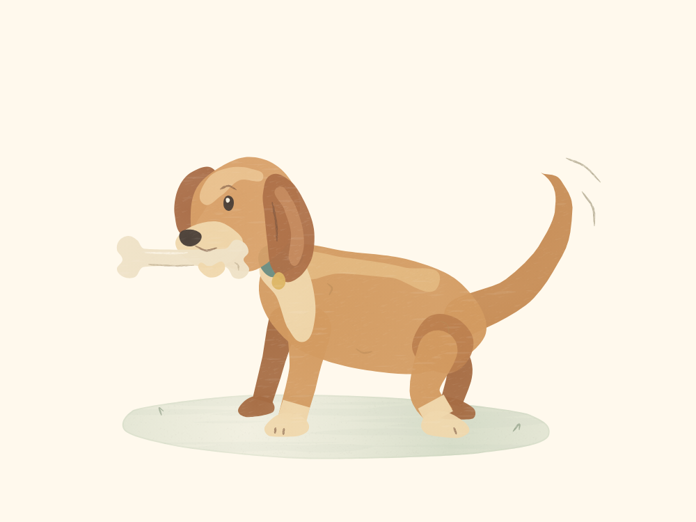
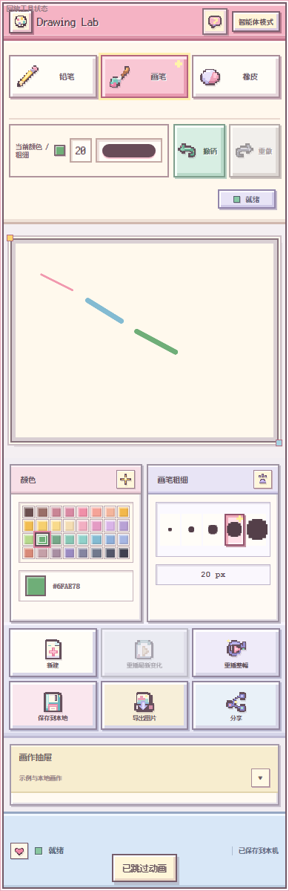

# Drawing Lab

Drawing Lab 是一个 local-first 的“真实操作绘画”实验项目。外部 AI 不提交
bitmap 成品，而是生成严格的 DrawingDocument operations：选择工具、设置颜色和
画笔粗细，再按顺序提交 stroke、erase、undo、redo 与 complete。Drawing Lab
验证这些操作、执行 Drawing Engine，并让用户看到同一份 canonical history 的
真实 Replay。

普通聊天客户端如果支持 Remote MCP 和工具调用，可以让 AI 直接创建或续画，
返回可点击 Result，并通过同一 DrawingDocument 派生的 PNG Preview 检查自己实际
画出的成品。Drawing Lab 本身不内置模型，也不提供模型额度。


《风中的来信》由 148 笔组成。脸颊用了低纸纹的薄色，发髻靠弧形墨线收束，外套则保留较粗的颗粒。上图是 Drawing Lab 从这幅作品的最终画布直接导出的 PNG。可以查看 AI 写下的[完整绘画指令](drawings/codex/wind-letter.steps.json)。

## 最新更新：中线＋宽度

AI 画尾巴、衣袖、丝带等细长形状时，现在可以只写**中线怎么弯、沿途有多宽**，
不用分别描两侧轮廓。MCP 的创建和续画工具都支持这种可选输入：
`spine: [[x, y, fullWidth], ...]`，再用 `caps` 指定两端是圆头还是平头。
它用于 `wash_fill` / `gouache_fill`；原有 `xy` 轮廓与线条画法继续保留，并可在一幅画里混用。



《捡到宝啦》的[完整 MCP 输入](drawings/codex/happy-dog.steps.json)由 Codex 直接生成，
没有先找参考图，通过一次本地 MCP 调用完成，看到预览后没有再改画稿。
共有 **45 笔绘制／填色、83 条操作**，其中 7 笔使用中线输入；全部展开后是 396 个路径点。
上图来自真实最终 Canvas 的 PNG 导出。相同输入随后通过了线上创建、结果恢复和自动
Replay 验证，线上最终画布与本地首稿逐像素一致。它是一次开发验收样例，不代表其他
模型在普通聊天里都能一次画到同样水平。

具体改动：

- **减少 AI 要填写的几何数据。** 接受 2–12 个中线站点及各处完整宽度；AI 仍自行决定
  路径、宽窄、颜色、材质和覆盖顺序。系统不自动设计题材、阴影或衣褶。
- **减少展开后的冗余点。** 保留影响颜料场的关键点，再以 0.25 个逻辑像素的容差简化
  派生轮廓。猫尾巴、衣袖、丝带三组局部实验的目标轮廓从合计 571 点降到 319 点，
  减少约 44%；三组目标形状的像素遮罩重合率均超过 99.8%，但并非逐像素完全相同。
- **仍然是原来的作品格式。** 新写法只在 MCP 输入层展开成一个已有的填色 stroke，
  然后走严格校验。生成的全部点和字节照常计入预算；不另存一套中线历史。
- **保留已有表现。** 没有改变 Engine、曲线渲染、Replay、PNG 导出或 MCP Preview。
  旧 `xy` 的坐标、`t`、圆滑／尖角和纸纹参数原样保留；撤销、重做和续画分支语义不变。

三组局部形状的输入 UTF-8 JSON 字节数分别为 330→184、313→178、842→477，
包含路径和颜色字段，约减少 43–44%。这是针对相同形状目标分别编写的两种输入，
不是整幅作品的通用压缩率，**也不是实测模型 token 节省比例**。展开点数减少主要节省
作品数据量，不会再减少 AI 已经输出的输入。

限制也很明确：宽度上限为 240 个逻辑单位，展开后不能超出画布；急转弯、过宽的形状
可能重叠，复杂不对称轮廓仍适合用 `xy`。这项能力让形状更容易表达，不保证模型自动
获得更好的构图或解剖能力。用法和错误边界见
[Agent Guide](docs/AGENT_GUIDE.md#centerline-and-width-for-elongated-fills)；MCP 客户端需要
获取更新后的 `tools/list` 定义才能使用新字段。

本次通过了 610 项自动断言、生产构建、MCP 创建／续画与线上浏览器验收。没有新增依赖。
宽度控制与端部选择的概念参考了
[Synfig Advanced Outline](https://wiki.synfig.org/Advanced_Outline_Layer)，轮廓展开及简化
由本项目独立实现，没有复制上游代码。[来源与授权说明](THIRD_PARTY_NOTICES.md)

## 已有绘画能力

- **线条有了轻重。** 软铅笔（`soft_pencil`）留下断续的石墨颗粒，墨刷（`ink_brush`）沿笔画变宽、收尖。短笔触可以点出睫毛，长笔触可以带出头发和衣褶。石墨、水彩和马克笔也可在同一张画中混用。
- **一圈轮廓就能铺色。** `wash_fill` 适合透出底色的罩染，`gouache_fill` 适合覆盖底色。轮廓可用 `smooth` 画出圆弧，用 `corners` 保留耳尖、衣领等转折。每块颜色都能单独回放和撤销。
- **纸纹可以按物体选择。** 两种填色工具都接受可选的 `grain`（0–1）。它只调节细纸纹，省略时沿用原效果。下图左侧是原作，右侧减轻了猫身的纸纹，再沿肩背和尾巴补了 14 笔；书封沿用原来的粗纹。[原作指令](drawings/codex/calico-nap.steps.json) · [新版指令](drawings/codex/calico-coat.steps.json)


- **AI 可以少写重复字段。** MCP 创建和续画都支持精简的 `steps`：同组笔画共用工具、颜色和粗细，用 `[x,y]` 指定路径。Drawing Lab 展开后逐笔严格校验。以新版三花为例，同一份输入从 22,624 字节降到 8,588 字节，展开后的绘画操作完全一致。这组数字测量的是 UTF-8 JSON 字节数。[输入示例与用法](docs/AGENT_GUIDE.md#compact-mcp-input)
- **回放中途可以直接看成画。** 修复了笔画画到一半跳过时，旧动画帧可能盖回最终画面的问题。智能体上下文也只在打开面板且需要时计算。

绘画技术参考了 [perfect-freehand](https://github.com/steveruizok/perfect-freehand) 的压力轮廓与收笔、[p5.brush](https://github.com/acamposuribe/p5.brush) 的颜料与纸纹，以及 [SketchAgent](https://github.com/yael-vinker/SketchAgent) 的逐笔表达。AI 指令转换参考了 [Doodle Agent](https://github.com/YIFANK/DoodleAgent) 和 [tldraw Agent](https://github.com/tldraw/agent-template)。绘画实现由本项目独立编写。[技术来源及第三方授权](THIRD_PARTY_NOTICES.md)

## 功能

- 固定 1000 × 750（4:3）canonical canvas。
- 严格、fail-closed 的 AgentDrawingPayload / DrawingDocument validation。
- 按 operation 顺序执行 Pencil、Brush、Eraser、颜色、粗细、Undo 与 Redo。
- Bézier 派生曲线路径、逐笔 Replay、Latest Replay 与跳过动画。
- 当前浏览器内的本地画作保存、更新、切换与删除。
- PNG 导出，以及可恢复 canonical history 的分享 Result。
- Provider-neutral Remote MCP：`create_drawing_result`、`continue_drawing_result`。
- 基于旧 Result 创建新 DrawingDocument 分支；源作品保持 immutable。
- 可选 Cloudflare Browser Run 派生 512 × 384 PNG Preview；失败不影响 Result。
- 小型网页分享可使用 self-contained Fragment；Hosted relay 使用加密临时结果。

<details>
<summary>查看手机界面</summary>



</details>

当前网页 canvas 是 operations 的查看与回放界面，不提供手指或鼠标自由绘制输入。
Agent Guide 中的 “Free Draw” 指 AI 自主决定题材并调用
`create_drawing_result`，不是第三套工具或手动画布模式。

## Quick start

要求 Node.js 20.19+ 或 22.12+。

```bash
npm install
npm run dev
```

打开 Vite 输出的本地地址即可使用基础 Drawing Lab。基础 UI、示例、validation、
Replay、本地保存和 PNG 导出不要求 Cloudflare 账号。

```bash
npm test
npm run build
npm run preview
```

`dist/` 是可重新构建的输出，默认不提交。

## AI / Remote MCP

公开协议说明见 [`docs/AGENT_GUIDE.md`](docs/AGENT_GUIDE.md)，canonical schema
见 [`public/drawing-schema.json`](public/drawing-schema.json)；精简 `steps` 与 `spine` 的
机器可读输入定义由 MCP `tools/list` 提供。自托管 MCP endpoint：

```text
https://YOUR_HOST/mcp
```

MCP 使用 Streamable HTTP，提供两个写工具：

- `create_drawing_result`：从真实 operations 创建新作品。
- `continue_drawing_result`：严格恢复 Drawing Lab Result，以新 ID 创建分支并追加
  operations；旧 Result 对应的 canonical document 不变。

Free Draw 是 `create_drawing_result` 的模型 guidance：用户不指定题材时，模型自行
决定构图、工具、颜色、粗细、stroke order 与完成时机。

### 模型用量提醒

Drawing Lab 不调用图像生成模型直接产出成品图。AI 会自行输出实际的结构化绘画
操作，包括工具、颜色、画笔粗细和笔画路径/坐标，再由 Drawing Lab Engine 执行并
Replay。

因此，复杂画作可能需要模型输出较多 structured operations，并消耗更多模型 token
或使用额度。实际消耗取决于模型、客户端、画作复杂度和修改轮数；这不是 Drawing
Lab 额外收取的费用。

聊天客户端能否调用这些工具、是否展示 MCP ImageContent，取决于客户端当前是否
支持 Remote MCP、write tool calls 与 image content；本项目不声称所有 ChatGPT、
Claude 或其他客户端版本都具备这些能力。

## Storage 与隐私

- **Local Drawings** 只保存在当前浏览器/设备，不是账号数据或云同步。清除站点
  数据、浏览器 profile 或 local storage 可能删除它们。
- 网页小作品分享可将压缩 canonical document 放在 URL fragment；拿到完整链接的
  人可以读取作品。
- Hosted encrypted relay 的 Result 默认保留 7 天。D1 只保存 ciphertext、IV 和
  必要 envelope metadata，不保存 encryption key 或 plaintext DrawingDocument。
- Relay key 只在 Result URL fragment 中。链接泄露意味着在有效期内可读取作品。
- MCP Worker 在 request 生命周期内会瞬时看到并验证 plaintext operations，但不应
  记录或持久化 plaintext、完整 Result URL 或 key。
- Preview 是同一 DrawingDocument 的 request-lifetime 派生 PNG，不写入 D1，不建立
  图片历史。Preview 不可用时，Drawing Result 仍可成功。

## Sharing

- **保存到本地**：保存完整 DrawingDocument，可 Replay，并可作为后续本地版本。
- **导出图片**：只导出当前最终画面的 4:3 PNG，不包含网页 UI。
- **分享**：创建可恢复 DrawingDocument 并自动 Replay 的 Result，不是 PNG 分享。

Core canonical hard cap 为 2 MiB。公开 Hosted handoff eligibility cap 为 1 MiB；
Hosted 限制不会改变 Core validator。

## Deployment

### Local-only / basic

运行 Vite 即可使用基础 Drawing Lab。没有 D1、Browser Run 或 Cloudflare binding 时，
不要期待公网 relay、Remote MCP 或云端 Preview。

### Full hosted / MCP / relay

当前参考部署为 Cloudflare Worker + Workers Static Assets + D1；Browser Run 是
Preview 的可选增强。Cloudflare 不是 DrawingDocument 或 Engine 的技术前提。

1. 构建前端：`npm run build`。
2. 复制 [`wrangler.example.jsonc`](wrangler.example.jsonc) 为被 gitignore 的
   `wrangler.local.jsonc`。
3. 只在本机配置自己的 `YOUR_D1_DATABASE_ID`、
   `YOUR_RATE_LIMIT_NAMESPACE_ID` 与精确 `YOUR_HOSTED_ORIGIN`。
4. 用 [`worker/d1-schema.sql`](worker/d1-schema.sql) 初始化自己的 D1。
5. 使用 Wrangler dry-run 检查后，再由维护者明确执行部署。

配置不应包含 Cloudflare token、登录邮箱、account ID、真实私有 URL 或任何
`VITE_*` secret。D1 只能通过 Worker binding 访问。没有 `BROWSER` binding 时，
MCP Preview 会明确降级为 unavailable，Result 仍保持成功。

完整 binding、TTL、cleanup 与防滥用说明见
[`worker/README.md`](worker/README.md)。

## Architecture

```text
Chat / Agent / MCP
        ↓
AgentDrawingPayload → strict validation → canonical DrawingDocument
                                              ↓
                              Drawing Engine → Replay / PNG export

Hosted Worker
├─ Static Assets
├─ /mcp
├─ encrypted result relay → D1 ciphertext + 7-day TTL
└─ optional Browser Run → derived PNG Preview
```

DrawingDocument / operation history 始终是作品真身；Fragment、checkpoint、Result、
PNG 与 Preview 都只是 transport 或 derived artifact。

## Public docs

- [Agent Guide](docs/AGENT_GUIDE.md)
- [AgentDrawingPayload schema](public/drawing-schema.json)
- [Worker deployment guide](worker/README.md)
- [Third-party notices](THIRD_PARTY_NOTICES.md)

## License

Drawing Lab 原创代码、明确标注的原创文档、pixel icon JSX 与示例 DrawingDocument
采用 [MIT License](LICENSE)。Copyright 使用中性主体
“Drawing Lab contributors”。

第三方字体、JavaScript dependencies 和其他第三方材料不因本项目采用 MIT 而改变
许可证。第三方授权、字体许可全文的位置，以及笔刷和 AI 绘画输入的技术参考，见
[`THIRD_PARTY_NOTICES.md`](THIRD_PARTY_NOTICES.md)。
